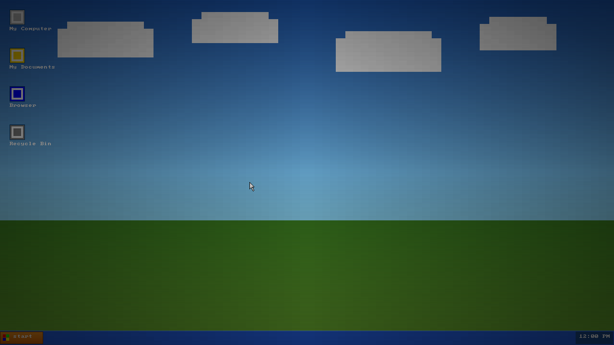

# RustOS

A small, bootable x86_64 operating system written from scratch in Rust. No
Linux, no `std`, no libc: the kernel owns the machine from the moment the
bootloader hands over the CPU until `shutdown`.



It boots on legacy BIOS **and** UEFI from the same kernel binary, draws a
framebuffer text console with its own 8x8 font renderer, mirrors everything to
COM1, sets up a heap, an IDT, the 8259 PIC and the PIT, and serves an
interactive shell over the PS/2 keyboard or a serial line.

## Features

- **Bare-metal kernel** (`#![no_std]`, `#![no_main]`, `x86_64-unknown-none`)
  entered through the `bootloader` 0.11 API, which provides BootInfo, a
  framebuffer, identity-free physical-memory mapping and a kernel stack.
- **One kernel, two firmware paths** – the build produces `rustos-bios.img` and
  `rustos-uefi.img`.
- **Bootable ISO** – the same kernel also ships as `rustos.iso`, a hand-written
  ISO9660 + El Torito disc image that boots under UEFI and is Ventoy-compatible.
- **Framebuffer console** – 8x8 bitmap font, scaled 1x–3x to target ~80 columns,
  ANSI-free colour palette, scrolling, tab/backspace/CR/LF handling, and a
  serial mirror on COM1 so the same text is machine-readable. When firmware
  reports no linear framebuffer, the console falls back to the legacy VGA text
  buffer at `0xb8000`, with all sixteen text colours, a hardware cursor and the
  same scrolling/wrapping logic (see [Console fallback](#console-fallback)).
- **Heap** – a fixed-size block allocator (a free list per size class with a
  `linked_list_allocator` fallback) over the top of the largest usable region,
  capped at 32 MiB, reached through the bootloader's physical-memory window
  (post-10 builds the heap and its `#[global_allocator]`; post-11 supplies the
  allocator's own design, and both are exercised in-QEMU by `basic_boot`).
- **Paging** – the kernel owns its page tables: `memory` reads `CR3`, walks the
  four-level table both by hand and through an `OffsetPageTable`, and can map a
  page from a frame allocator over the bootloader's memory map. `usermode` builds
  the ring-3 window on the same tables, and the in-QEMU tests exercise the paging
  API directly (post-08).
- **Interrupts** – own IDT (with CPU-exception reporters), 8259A remap to
  vectors 0x20–0x2F, PIT at 100 Hz, IRQ1 keyboard, IRQ4 COM1. The double-fault
  handler runs on its own interrupt stack (a GDT + TSS + IST), so a kernel stack
  overflow is caught instead of triple-faulting the machine. Every lock a handler
  shares with the main thread (the serial/console print path, the VGA text
  buffer) is taken inside `without_interrupts`, so a handler that prints can
  never deadlock the thread it interrupted (post-07).
- **Input** – lock-free SPSC ring buffer shared by the keyboard and serial IRQ
  handlers; PS/2 scancode set 1 with Shift and Caps Lock.
- **Windows XP-style desktop** – when a framebuffer is available the kernel boots
  straight into a Luna-blue desktop: a vertical gradient, a taskbar with a green
  **start** button, draggable windows with blue title bars and close buttons, a
  Start menu, and a PS/2 mouse-driven arrow pointer. See
  [Desktop environment](#desktop-environment).
- **Shell** – `help`, `echo`, `clear`, `mem`, `heap`, `alloc`, `uptime`, `cpu`,
  `logo`, `about`, `net`, `dhcp`, `ping`, `dns`, `http`, `beep`, `tone`, `disks`,
  `ls`, `cat`, `write`, `rm`, `play`, `format`, `run`, `pkg`, `panic`, `reboot`,
  `shutdown`.
- **Networking** – an RTL8139 driver plus a hand-written IPv4 stack (ARP, ICMP,
  UDP, DNS and a synchronous TCP client) with a DHCP client, so the OS can
  `ping`, resolve host names and fetch web pages over HTTP. See
  [Networking](#networking).
- **Sound** – an AC'97 driver that plays PCM WAV files and synthesised tones
  through QEMU's audio backend. See [Audio](#audio).
- **Disks** – an ATA PIO driver and a read/write FAT16 filesystem, so the OS can
  list, create, read, overwrite and delete files on a real IDE disk. See
  [Disks and the FAT16 filesystem](#disks-and-the-fat16-filesystem).
- **User mode** – a real ring-3 execution environment: its own GDT, a TSS with a
  dedicated ring-0 stack, a private page-table window and an `int 0x80` system
  call gate, so flat binaries run with hardware isolation. See
  [User mode (ring 3)](#user-mode-ring-3).
- **Tests** – an in-QEMU `cargo test` framework (`cargo xtest`) runs unit and
  integration tests inside the kernel itself, and an end-to-end smoke test boots
  the image, drives the shell over a TCP-attached COM1 and asserts on the
  transcript, for both BIOS and UEFI. See [Testing](#testing).

## Requirements

| Tool | Why | Installed by `scripts\setup.ps1` |
| --- | --- | --- |
| Rust nightly (`x86_64-pc-windows-gnu` host) | `abi_x86_interrupt`, `alloc_error_handler`, Cargo artifact dependencies | yes |
| `x86_64-unknown-none`, `x86_64-unknown-uefi` targets | kernel and UEFI bootloader | yes |
| MinGW-w64 (`gcc`, `as`, `dlltool`) | GNU host linker for build scripts | yes (WinLibs via winget) |
| QEMU 8+ (`qemu-system-x86_64`) | running the images; OVMF `edk2-*.fd` for UEFI | yes |
| PowerShell 5.1+ | helper scripts | Windows built-in |

The repository pins the toolchain per directory (`rustup override`), so the
rest of your machine is untouched. The nightly is required: the kernel uses
`#![feature(abi_x86_interrupt)]`, `#![feature(alloc_error_handler)]` and
`#![feature(custom_test_frameworks)]` (the in-QEMU test harness), and
`Cargo.toml` uses the `artifact = "bin"` dependency form gated behind
`-Z bindeps`.

## Quick start

```powershell
# 1. Install Rust nightly, MinGW-w64 and QEMU (idempotent, no admin needed)
powershell -ExecutionPolicy Bypass -File scripts\setup.ps1

# 2. Build the kernel and both disk images (add --release for an optimised build)
powershell -ExecutionPolicy Bypass -File scripts\build.ps1

# 3. Boot it (BIOS by default; use "uefi" for OVMF, "iso" for the disc image)
powershell -ExecutionPolicy Bypass -File scripts\run.ps1
powershell -ExecutionPolicy Bypass -File scripts\run.ps1 uefi
powershell -ExecutionPolicy Bypass -File scripts\run.ps1 uefi iso

# 4. Run the kernel's in-QEMU tests (unit + integration; needs QEMU)
cargo xtest

# 5. Prove it works without clicking anything
powershell -ExecutionPolicy Bypass -File scripts\smoke-test.ps1
powershell -ExecutionPolicy Bypass -File scripts\smoke-test.ps1 -Firmware uefi
powershell -ExecutionPolicy Bypass -File scripts\smoke-test.ps1 -Release
powershell -ExecutionPolicy Bypass -File scripts\smoke-test.ps1 -Firmware uefi -Iso
```

`scripts\run.ps1` forwards its arguments to the host launcher, so
`scripts\run.ps1 --headless`, `scripts\run.ps1 uefi`, and
`scripts\run.ps1 -- -smp 2 -cpu max` all work. Extra QEMU arguments go after
`--`.

Equivalent raw commands, if you prefer not to use the PowerShell wrappers:

```powershell
cargo build                 # produces target\debug\build\rustos\*\out\rustos-{bios,uefi}.img and rustos.iso
cargo run -- bios --headless
cargo run -- uefi iso       # boot the ISO from a virtual CD-ROM
```

`scripts\screenshot.ps1` boots the BIOS image headlessly, waits for the Windows
XP-style desktop to render, moves the pointer and writes `target\screenshot.png`
via QEMU's `screendump` (useful for docs).

### Shell commands

| Command | Effect |
| --- | --- |
| `help` | list commands |
| `echo <text>` | echo text back |
| `clear` | clear the framebuffer |
| `mem` | dump the bootloader memory map |
| `heap` | show the kernel heap window |
| `alloc` | allocate and free 78 KiB on the heap |
| `uptime` | seconds since boot, from the PIT |
| `cpu` | CPUID vendor and brand string |
| `logo` | redraw the banner |
| `about` | what this OS is |
| `net` | show the adapter, address, gateway and DNS server |
| `dhcp` | (re)acquire an address from a DHCP server |
| `ping <ip>` | send an ICMP echo request |
| `dns <name>` | resolve a host name through the DNS proxy |
| `http <url>` | fetch a page over HTTP and print the response |
| `beep` | play a short tone through AC'97 audio |
| `tone <hz> [ms]` | play a tone of the given frequency and duration |
| `disks` | list the ATA drives and their sizes |
| `ls` / `dir` | list the FAT16 data disk's root directory |
| `cat <file>` / `type` | print a file from the data disk |
| `write <file> <text>` | create or overwrite a file (or read lines until `.`) |
| `rm <file>` | delete a file |
| `play <file>` | play a WAV file from the data disk through AC'97 |
| `format` | reformat the FAT16 data disk |
| `run [file]` | run a flat ring-3 program (no file: the built-in demo) |
| `pkg list` | list the in-OS package registry |
| `panic` | trigger a kernel panic (tests the panic path) |
| `reboot` | pulse the keyboard controller reset line |
| `shutdown` | power off via QEMU's `isa-debug-exit` (halts elsewhere) |

## Networking

RustOS speaks IPv4 on the emulated RTL8139 that QEMU attaches for
`-nic user,model=rtl8139` (the launcher and the test scripts pass that flag).
At boot the kernel runs a **DHCP** client, so it takes whatever address the
network hands out; if no server answers within half a second it falls back to
the fixed defaults you would see on any QEMU guest, which QEMU's user-mode
network ("SLIRP") always provides:

| Setting | Value |
| --- | --- |
| Guest address | `10.0.2.15/24` |
| Gateway | `10.0.2.2` |
| DNS proxy | `10.0.2.3` |
| MAC | `52:54:00:12:34:56` |

The stack is split across two modules:

- `kernel/src/pci.rs` scans PCI bus 0 through the `0xCF8`/`0xCFC` configuration
  ports, finds the adapter, and enables its I/O space and bus-master bit.
- `kernel/src/net.rs` is the driver and the protocol stack: the RTL8139 receive
  ring and four transmit descriptors, Ethernet framing, ARP, IPv4, ICMP echo,
  UDP, a DNS resolver and a synchronous TCP client behind `http_get`.

The driver is **polled** from the shell rather than interrupt-driven, so the
whole stack stays single-threaded and the receive path is a plain "read the ring,
advance `CAPR`" loop. DMA buffers are carved out of the kernel heap, which lives
in the bootloader's physical-memory window, so the physical address the NIC needs
is simply `virtual_address - physical_memory_offset`.

Try it from the shell:

```
rustos> net
adapter: RTL8139, I/O 0xc000, IRQ 11
address: 10.0.2.15
mac:     52:54:00:12:34:56
gateway: 10.0.2.2
dns:     10.0.2.3
rustos> ping 10.0.2.2
PING 10.0.2.2 ... reply in 0 ms
rustos> dns example.com
resolving example.com ... example.com -> 93.184.216.34
rustos> http http://example.com/
GET http://example.com/
HTTP/1.1 200 OK
...
```

`ping`, `dns` and `http` reach beyond the gateway only when the host has
connectivity; the gateway itself always answers because SLIRP implements the
virtual host locally. Off-subnet traffic is sent to the gateway's MAC while
keeping the real destination in the IP header, because SLIRP only answers ARP for
the addresses it owns.

The Windows XP-style **Browser** window has an editable address bar: type a URL,
press **Enter** (or click **Go**) and it fetches the page over HTTP with
`net::http_get`, converts the HTML to text (`kernel/src/browser.rs`) and shows the
title, status line and body. The fetch blocks the UI for its duration, then
returns to normal; the arrow and Page Up/Down keys scroll the rendered page.

### Testing the network

The smoke test always checks the adapter and pings the gateway. Pass `-Network`
to also resolve a name and fetch a page, which needs the host to have internet
access:

```powershell
powershell -ExecutionPolicy Bypass -File scripts\smoke-test.ps1 -Network
```

## Audio

RustOS plays sound through an emulated **AC'97** codec (PCI `8086:2415`). The
driver in `kernel/src/audio.rs` finds the device on the PCI bus, programs the
native-audio mixer and bus-mastering registers, and feeds the codec from a
32-entry buffer descriptor list: it allocates a PCM buffer, points the
descriptors at it and lets the codec's DMA engine read it out.

`beep` and `tone <hz> [ms]` synthesise a square wave directly, while
`play <file>` reads a PCM WAV file off the FAT16 data disk, parses its header and
streams the samples. The shell waits for playback to finish (the driver polls the
codec's current-index register) so the prompt returns only when the sound is
done.

QEMU's audio backend is selectable on the launcher:

```powershell
scripts\run.ps1 --audio wav       # default: record playback to audio.wav
scripts\run.ps1 --audio dsound    # live output through DirectSound
scripts\run.ps1 --audio none      # no audio device
```

`wav` is the default because it always works, including on hosts where the
DirectSound backend refuses to open a device; `dsound` gives you live sound when
your host supports it. The smoke test uses the `wav` backend and asserts that the
captured file contains real (non-zero) samples, which is how the driver is
verified without a speaker.

## Disks and the FAT16 filesystem

The kernel talks to the primary IDE channel with a polled **ATA PIO** driver
(`kernel/src/ata.rs`, LBA28, ports `0x1F0`/`0x3F6`). On top of it sits a
read/write **FAT16** implementation (`kernel/src/fat.rs`) with `mount`, `list`,
`read`, `write`, `delete` and `format`, exposed through the `disks`, `ls`, `cat`,
`write`, `rm`, `play` and `format` shell commands.

Two drives are attached: the boot image on the primary master (drive 0) and a
16 MiB data disk on the primary slave (drive 1). `build.rs` creates the data disk
at the project root as `rustos-data.img` **only if it is missing**, so anything
you write from inside RustOS survives a rebuild. It is seeded once with
`README.TXT`, a tone (`BEEP.WAV`) and a ring-3 program (`HELLO.BIN`). Delete the
file and rebuild to regenerate a pristine image.

```
rustos> disks
drive 0 (master): 5 MiB, 11202 sectors
  model: QEMU HARDDISK
drive 1 (slave): 16 MiB, 32768 sectors
  model: QEMU HARDDISK
rustos> write NOTES.TXT hello from RustOS
wrote 19 bytes to NOTES.TXT
rustos> cat NOTES.TXT
hello from RustOS
```

## User mode (ring 3)

Programs run with real hardware isolation. `kernel/src/usermode.rs` installs its
own GDT (null, kernel code/data, user code/data and a TSS), points the TSS
`privilege_stack_table[0]` at a dedicated 16 KiB ring-0 stack and its
`interrupt_stack_table[0]` at a separate 16 KiB double-fault stack (post-06), and
maps a private 64 KiB program window plus a 16 KiB stack at PML4 entry 1
(`0x0000_0080_0000_0000`), far from the kernel's identity map and the
physical-memory window.

The only way in is `int 0x80`, installed as a DPL-3 gate. The handler is written
in `global_asm!`: it saves the user registers, calls the Rust dispatcher and
`iretq`s back. Two system calls exist today — `exit(status)` (0) and
`write(fd, buffer, length)` (1) — which is enough for a program to print and
return. A fault taken in ring 3 is contained: the exception handler notices the
faulting `CS` has RPL 3, reports it and terminates the program, handing control
back to the shell instead of halting the machine.

`run` with no argument executes a hand-assembled demo program built in memory;
`run HELLO.BIN` loads a flat binary off the data disk. A flat binary is linked
against the user base, so it is position-dependent by design:

```
rustos> run
running demo program (71 bytes) in ring 3 ...
Hello from ring 3! (via int 0x80)
demo program exited with status 0
rustos> run HELLO.BIN
running HELLO.BIN (77 bytes) in ring 3 ...
Hello from HELLO.BIN running in ring 3!
HELLO.BIN exited with status 0
```

Because `exit_user` returns to the kernel with `ret` rather than `iretq`, it
restores the kernel's saved `RFLAGS` by hand — without that, the `int 0x80`
interrupt gate would leave interrupts disabled and the shell's `hlt` would never
wake again.

## Bootable ISO and Ventoy

`cargo build` also writes `rustos.iso` next to the disk images, under
`target\<profile>\build\rustos\<hash>\out\`:

```
target\debug\build\rustos\*\out\rustos.iso
```

The ISO is written by `build\iso.rs`, a small dependency-free ISO9660 + El
Torito writer (there is no `xorriso`/`mkisofs` requirement). It contains:

- a Primary Volume Descriptor and an El Torito Boot Record Volume Descriptor,
- a minimal directory tree with `EFI\BOOT\BOOTX64.EFI`,
- a boot catalog whose default entry is the BIOS MBR image (hard-disk
  emulation) and whose EFI section points at the UEFI FAT image (no emulation).

Boot it in QEMU from a virtual CD-ROM with:

```powershell
powershell -ExecutionPolicy Bypass -File scripts\run.ps1 uefi iso
# or: cargo run -- uefi iso
```

### Using the ISO on a Ventoy USB stick

1. Build it (`scripts\build.ps1`, or `scripts\build.ps1 --release`).
2. Copy `rustos.iso` to the first, exFAT/NTFS partition of a Ventoy drive.
3. Boot the drive and pick `rustos.iso` from the Ventoy menu.

Ventoy's UEFI path reads the EFI El Torito entry and chainloads its own
`ventoy_x86_64.efi`; this has been verified in QEMU (`scripts\smoke-test.ps1
-Firmware uefi -Iso`). Ventoy's legacy-BIOS path loads the El Torito BIOS image
through iPXE, which supplies the extended INT 13h calls the `bootloader` stage 1
needs. That path has **not** been tested on real hardware.

> **BIOS CD-ROM caveat.** A *plain* BIOS boot from the ISO (SeaBIOS/`-cdrom`
> without Ventoy) does **not** work: SeaBIOS only implements old-style INT 13h
> for its El Torito emulated drive, while the `bootloader` stage 1 requires
> INT 13h extensions (AH=0x41/0x42). Booting the BIOS path directly from the ISO
> therefore prints nothing. Use the disk image (`scripts\run.ps1 bios`), Ventoy,
> or a real optical drive for the BIOS path.

### Ventoy fallback: raw disk images

Ventoy also boots raw `.img` files, so `rustos-bios.img` and `rustos-uefi.img`
can be copied to the drive directly if you prefer not to use the ISO. Pick the
image that matches the firmware you are booting.

## Project layout

```
Cargo.toml               workspace + host launcher package (the kernel is excluded)
.cargo\config.toml       cargo `runner` (in-QEMU tests) + the `xtest` alias
build.rs                 turns the kernel artifact into BIOS/UEFI disk images and the ISO
build\iso.rs             dependency-free ISO9660 + El Torito disc image writer
src\main.rs              host launcher: locates QEMU/OVMF, boots an image or the ISO
kernel\
  Cargo.toml             freestanding kernel (its own workspace): library + thin binary (x86_64-unknown-none)
  src\main.rs            binary: bootloader entry point, panic/alloc handlers
  src\lib.rs             kernel library: kernel_main, boot log, test framework
  src\console.rs         framebuffer text console + print!/println! macros
  src\vga.rs             legacy VGA text-mode console fallback (0xb8000)
  src\volatile.rs        Volatile<T>: the one place raw device pointers are read/written
  src\font.rs            generated 8x8 bitmap font
  src\memory.rs          heap selection, the global allocator and the paging layer (post-08, post-10/11)
  src\allocator.rs       the Locked wrapper and the allocator designs module (post-11)
  src\allocator\bump.rs   the bump allocator design
  src\allocator\linked_list.rs  the linked-list (free-list) allocator design
  src\allocator\fixed_size_block.rs  the fixed-size block allocator design (the one installed)
  src\interrupts.rs      IDT, PIC remap, PIT, IRQ handlers, exception reports
  src\input.rs           lock-free input ring buffer
  src\keyboard.rs        PS/2 scancode set 1 → ASCII
  src\mouse.rs           PS/2 mouse driver (8042 aux port, 3-byte packets)
  src\pci.rs             PCI bus-0 configuration-space scan (0xCF8/0xCFC)
  src\net.rs             RTL8139 driver + IPv4/ARP/ICMP/UDP/DNS/TCP stack + DHCP
  src\audio.rs           AC'97 codec driver (DMA buffer descriptor list)
  src\ata.rs             ATA PIO driver for the primary IDE channel (LBA28)
  src\fat.rs             read/write FAT16 filesystem
  src\browser.rs         HTML-to-text renderer for the desktop Browser window
  src\usermode.rs        ring 3: GDT/TSS/paging, int 0x80 syscalls, program loader
  src\serial.rs          16550 UART driver for COM1
  src\wm.rs              Windows XP-style desktop: taskbar, windows, cursor
  src\shell.rs           banner, boot log helpers, shell and commands
  tests\basic_boot.rs    in-QEMU integration test (boot, serial, VGA fallback)
  tests\should_panic.rs  in-QEMU test that the harness notices a panic
  tests\stack_overflow.rs in-QEMU test that a stack overflow double-faults onto the IST stack
runner\
  Cargo.toml             host-side cargo test runner package
  src\main.rs            wraps a test ELF in a disk image, boots QEMU, maps exit code
                         (`--image <elf> [<out.img>]` only builds the image)
examples\
  minimal\               standalone `blog_os` post-02+ crate: safe VGA console,
                         its own README, host `cargo test` + in-QEMU test (not in the workspace)
  vga-text\              standalone `blog_os` post-03 crate: safe VGA text
                         writer, its own README, host `cargo test` + in-QEMU test (not in the workspace)
  testing\               standalone `blog_os` post-04 crate: the in-QEMU test
                         framework itself, always `no_std` (not in the workspace)
  cpu-exceptions\        standalone `blog_os` post-05 crate: the IDT and the CPU
                         exception handlers, always `no_std` (not in the workspace)
  double-faults\         standalone `blog_os` post-06 crate: the GDT/TSS/IST that
                         catches a stack-overflow double fault, always `no_std`
                         (not in the workspace)
  hardware-interrupts\   standalone `blog_os` post-07 crate: the 8259 PIC, the
                         PIT timer, the keyboard and the `without_interrupts`
                         print-lock fix, always `no_std` (not in the workspace)
  paging\                standalone `blog_os` post-08 crate: `CR3`, the four-level
                         table walk, the `OffsetPageTable` mapper and a frame
                         allocator, always `no_std` (not in the workspace)
  heap-allocation\       standalone `blog_os` post-10 crate: the heap region, the
                         `#[global_allocator]` and `Box`/`Vec`/`Rc`, always
                         `no_std` (not in the workspace)
  allocator-designs\     standalone `blog_os` post-11 crate: the bump, linked-list
                         and fixed-size block allocators, always `no_std`
                         (not in the workspace)
build\
  iso.rs                 ISO9660 + El Torito writer
  fat16.rs               host-side FAT16 image builder (seeds the data disk)
scripts\
  setup.ps1              one-shot toolchain installer
  env.ps1                shared PATH/toolchain detection, dot-sourced
  build.ps1, run.ps1     thin wrappers around cargo
  minimal.ps1            build + boot (or -Test) the `examples/minimal` kernel
  vga-text.ps1           build + boot (or -Test) the `examples/vga-text` kernel
  testing.ps1            build + boot (or -Test) the `examples/testing` kernel
  cpu-exceptions.ps1     build + boot (or -Test) the `examples/cpu-exceptions` kernel
  double-faults.ps1      build + boot (or -Test) the `examples/double-faults` kernel
  hardware-interrupts.ps1 build + boot (or -Test) the `examples/hardware-interrupts` kernel
  paging.ps1             build + boot (or -Test) the `examples/paging` kernel
  heap-allocation.ps1    build + boot (or -Test) the `examples/heap-allocation` kernel
  allocator-designs.ps1  build + boot (or -Test) the `examples/allocator-designs` kernel
  smoke-test.ps1         end-to-end boot test (BIOS and UEFI; -Iso for the disc image)
  screenshot.ps1         capture the desktop framebuffer to PNG
tools\
  gen-font.ps1           regenerates kernel\src\font.rs from font8x8_basic.h
  font8x8_basic.h        public-domain 8x8 font data
```

## How it works

**Boot.** `build.rs` asks the `bootloader` crate to wrap the compiled kernel ELF
into a FAT disk image (BIOS: MBR + stages 2–4; UEFI: an `.efi` application).
Firmware loads the image, the bootloader sets up paging, maps the kernel, a
stack, the framebuffer, BootInfo and a window onto physical memory, then jumps to
`kernel_main` in long mode.

**Configuration.** `BOOTLOADER_CONFIG` in `kernel/src/main.rs` sets a 512 KiB
kernel stack and enables `mappings.physical_memory = Dynamic`, which is what
gives the kernel a virtual window onto RAM (`BootInfo::physical_memory_offset`).
The default configuration maps no physical memory at all, so a kernel that wants
a heap must ask for it.

**Console.** `console::init` takes the framebuffer, picks a glyph scale of
`min(width / (8*80), height / (9*25))` clamped to 1–3 (so a 1280x720 BIOS screen
is 80x40 cells) and paints the screen. Every write goes to COM1 first, then to
the framebuffer, so a crash in the renderer still leaves a serial log.

**Heap.** `memory::init` picks the largest usable region that does not overlap
the kernel image, takes its top 32 MiB, and hands
`physical_memory_offset + address` to the global allocator. That allocator is
post-11's fixed-size block design (`kernel/src/allocator/`): one free list per
power-of-two size class, with a `linked_list_allocator` fallback for large
requests, so a freed block is reused immediately instead of waiting for the whole
heap to empty. Nothing may allocate before that point: the banner and boot log
deliberately use `format_args!` rather than `format!`.

**Interrupts.** Before the IDT is loaded, `usermode::init_gdt` installs the GDT
and TSS, including the interrupt stack the double-fault handler runs on (post-06);
the IDT entry names that stack, so it must already be loaded. Then
`interrupts::init` remaps the 8259 PIC (IRQ0–7 → 0x20–0x27,
IRQ8–15 → 0x28–0x2F), loads the IDT, programs the PIT for 100 Hz and unmasks
IRQ0, IRQ1, IRQ2, IRQ4, IRQ12 (remember: a set bit in the PIC's IMR *masks* a
line). Handlers send EOI and push bytes into `input`, a 256-byte SPSC ring
buffer that the shell drains while halted with `hlt`.

## Console fallback

When the bootloader reports a linear framebuffer, `console::init` renders into
it. When it reports none — a firmware that could not set a video mode, or a
deliberate `-vga none` run — `kernel/src/vga.rs` takes over the 80x25 text
buffer the firmware has already set up at physical `0xb8000`. The buffer is
device memory, so it is reached through the bootloader's physical-memory window
(`physical_memory_offset + 0xb8000`) and only touched through the `Volatile<T>`
wrapper in `kernel/src/volatile.rs` (`read_volatile`/`write_volatile`); the
module owns the cursor, the colour attribute and scrolling, and never hands out a
raw pointer. All sixteen text colours are available (`set_fg`/`set_bg`/
`set_color`), and the hardware cursor is programmed through the CRTC at ports
`0x3D4`/`0x3D5`.

The console's named colours keep their meaning here: `console::Color::to_vga_text`
maps them to their intended text colour (the muted success green becomes the
bright text green, not grey), and any other 24-bit colour is snapped to the
nearest palette entry by `vga::Color::from_rgb`. If there is neither a
framebuffer nor a physical-memory window, the kernel falls back to serial-only
output and says so in the boot log.

The writer's grid is abstracted behind a small `Buffer` trait, so the unit tests
at the bottom of `kernel/src/vga.rs` drive the same scrolling, wrapping,
backspace, colour and cursor logic against a RAM buffer instead of a live device.
That matters because QEMU plus the bootloader *always* end up in
linear-framebuffer graphics mode, which leaves the legacy text aperture at
`0xb8000` unbacked: the RAM-backed tests exercise the logic deterministically,
while the `basic_boot` integration test only checks that the fallback path
initializes, tracks colours and does not fault.

`examples/minimal/` is a standalone teaching crate that starts from `blog_os`
post-02 (a raw `*mut u8` write to `0xb8000`) and rebuilds it with the same safe
writer; [`examples/vga-text/`](examples/vga-text/README.md) does the same for
post-03, keeping that post's `vga_buffer` names. A byte the text mode cannot
render shows the CP437 `0xfe` box (post-03's choice) rather than disappearing.
[`examples/testing/`](examples/testing/README.md) is post-04 — the *Testing* post
— rebuilt around this repository's conventions; it is the crate that carries the
in-QEMU test framework the kernel's own `cargo xtest` uses.
[`examples/cpu-exceptions/`](examples/cpu-exceptions/README.md) is post-05 — the
*CPU Exceptions* post — an IDT with divide-error, invalid-opcode, breakpoint,
double-fault, general-protection and page-fault handlers, each recording what it
saw so a test can assert the handler ran.
[`examples/double-faults/`](examples/double-faults/README.md) is post-06 — the
*Double Faults* post — which gives the double-fault handler a real interrupt
stack (a GDT, a TSS and the interrupt stack table) so a kernel stack overflow is
caught instead of triple-faulting.
[`examples/hardware-interrupts/`](examples/hardware-interrupts/README.md) is
post-07 — the *Hardware Interrupts* post — which remaps the 8259 PIC, programs
the PIT, decodes the keyboard and takes the print lock inside
`without_interrupts`, so a handler that prints cannot deadlock the main thread.
[`examples/paging/`](examples/paging/README.md) is post-08 — the *Introduction to
Paging* post together with the paging *implementation* — which reads `CR3`, walks
the four-level table, maps a page through an `OffsetPageTable` and hands out
frames from the bootloader's memory map.
[`examples/heap-allocation/`](examples/heap-allocation/README.md) is post-10 — the
*Heap Allocation* post — which maps a heap through the paging layer, installs a
`#[global_allocator]`, and uses `Box`, `Vec` and `Rc`.
[`examples/allocator-designs/`](examples/allocator-designs/README.md) is post-11 —
the *Allocator Designs* post — which replaces that implementation with three
designs written from scratch (a bump allocator, a linked-list allocator and a
fixed-size block allocator) and installs the last.

## Desktop environment

When firmware reports a linear framebuffer the kernel boots straight into a
Windows XP-style desktop instead of the text shell (a serial-only boot still
falls back to the shell). Any byte arriving on COM1 hands the console back to
the shell, so a headless test can still drive the shell even though the desktop
owns the screen. `kernel\src\wm.rs` draws everything with `put_pixel` on the
framebuffer. The whole scene is composed in an off-screen back buffer and copied to the
framebuffer in one pass, so a click never exposes a half-drawn frame; moving the
pointer just restores the 12x19 pixels it left behind (kept in a small backing
store) and redraws it at the new spot, so the cursor glides instead of
flickering through a full-screen repaint:

- a vertical blue gradient wallpaper,
- a taskbar along the bottom with a green **start** button that opens a Start
  menu; the Start-menu entries open real windows (My Computer, Control Panel,
  Command Prompt, Run..., About RustOS, Log Off, Shut Down), and the taskbar
  window buttons raise their window when clicked,
- draggable windows with Luna-blue title bars, a close button (which frees the
  slot so a window can be reopened), and a drop shadow; the desktop starts empty
  at boot and windows open on demand from the Start menu or the desktop icons,
- a classic 12x19 arrow pointer whose hotspot is the top-left pixel.

Input comes from `kernel\src\mouse.rs`, a PS/2 driver for the 8042 auxiliary
port. It configures the controller with the mouse interrupt (IRQ12) **masked**
during the command handshake and enables it only once the mouse is streaming, so
the ACK bytes cannot be stolen by the interrupt handler. `handle_byte`
resynchronises on the first packet byte (bit 3 must be set), which discards stray
bytes and keeps the pointer from drifting.

> **QEMU: click inside the window first.** QEMU does not forward mouse motion
> until its pointer is *grabbed*, which happens when you click in the guest
> window (press **Ctrl+Alt+G** to release it again). Until then the cursor will
> not move, even though the driver is working.

## Linux package

RustOS is available as a Linux package:

- **Debian/Ubuntu**: `sudo dpkg -i rustos_0.1.0_amd64.deb`
- **Universal tarball**: `tar -xzf rustos-0.1.0-linux.tar.gz -C /`

The package installs to `/opt/rustos/` and `/usr/bin/rustos`. Requires `qemu-system-x86_64`.

## Testing

RustOS has two layers of tests: an **in-QEMU `cargo test`** suite that runs
inside the kernel, and an **end-to-end smoke test** that boots a real image and
drives the shell.

### In-QEMU `cargo test`

A bare-metal binary cannot run under the host's test harness, so `cargo test`
links the kernel's test binaries for `x86_64-unknown-none` and hands each one to
a runner (`runner/`, wired up as the `runner` key in `.cargo\config.toml`). The
runner wraps the test ELF in a bootable BIOS disk image with the `bootloader`
crate, boots it in QEMU with `-device isa-debug-exit` and COM1 on stdout, and
maps QEMU's exit code back onto its own (the framework writes `0x10` on success,
which QEMU reports as exit code 33).

```powershell
cargo xtest        # == cargo test --manifest-path kernel\Cargo.toml --target x86_64-unknown-none
```

The kernel is its own workspace (it only builds for the bare-metal target), so it
is addressed by manifest path; the host workspace at the root excludes it.

Four test binaries run:

- **unit tests** in `kernel/src/lib.rs` and its modules (`cargo test --lib`);
  the `vga` module's tests drive the console writer against a RAM buffer,
- **`tests/basic_boot.rs`** — an integration test with its own `entry_point!`,
  checking the serial path, the physical-memory window, the VGA fallback path
  and a breakpoint exception (post-05: an `int3` must be handled and return),
  the timer (post-07: the tick count advances, and printing through the same
  lock while the timer fires does not deadlock), the paging API (post-08:
  the hand-written walk and the mapper agree, and a freshly mapped page reads
  back), and the kernel heap (post-10/11: a `Box` and a growing `Vec` round-trip
  through the global allocator with the pointer landing in the heap window, the
  installed design is the fixed-size block allocator, and a long-lived allocation
  does not starve the heap),
- **`tests/should_panic.rs`** (`harness = false`) — asserts that the harness
  notices a panicking test,
- **`tests/stack_overflow.rs`** (`harness = false`) — post-06: overflows the
  kernel stack, and asserts the resulting double fault is handled on the
  dedicated interrupt stack instead of triple-faulting.

Test output goes to COM1; a failure panics and exits QEMU with the failure code.
The framework lives in `kernel/src/lib.rs` (`Testable`, `test_runner`,
`exit_qemu`, `serial_print!`/`serial_println!`), and every test binary reaches
the entry point through `entry_point!` so its ELF carries the
`.bootloader-config` section the bootloader needs in order to load it.

This is `blog_os` post-04's test framework, hardened. The public surface is the
same (`Testable`, `test_runner`, `test_main`, `QemuExitCode`, `exit_qemu`,
`serial_print!`/`serial_println!`), but the test entry point goes through
`entry_point!` instead of post-04's bare `#[unsafe(no_mangle)] _start` (so the
test ELF carries `.bootloader-config` without `bootimage`), `exit_qemu` returns
`!`, and the `runner` adds a 60-second timeout on top of post-04's exit-code
mapping. [`examples/testing`](examples/testing/README.md) is that same framework
as a standalone post-04 crate.

The runner also has an `--image <elf> [<out.img>]` mode that only builds the
bootable disk image and prints its path; `scripts\minimal.ps1`,
`scripts\vga-text.ps1`, `scripts\testing.ps1`, `scripts\cpu-exceptions.ps1`,
`scripts\double-faults.ps1`, `scripts\hardware-interrupts.ps1`,
`scripts\paging.ps1`, `scripts\heap-allocation.ps1` and
`scripts\allocator-designs.ps1` use it to boot their standalone `examples/`
kernels.

The `examples/` crates are a small `blog_os`-post-by-post series, each with its
own README: post-02 (`minimal`), post-03 (`vga-text`), post-04 (`testing`),
post-05 (`cpu-exceptions`), post-06 (`double-faults`), post-07
(`hardware-interrupts`), post-08 (`paging`), post-10 (`heap-allocation`) and
post-11 (`allocator-designs`).
Each builds standalone and is deliberately *not* part of the host workspace.
`minimal` and `vga-text` are dual-mode — `no_std` for the kernel, `std` under
`cfg(test)` — so their unit tests (14 and 15 respectively) run on the **host**
with no QEMU:

```powershell
cargo test --manifest-path examples\minimal\Cargo.toml --lib
cargo test --manifest-path examples\vga-text\Cargo.toml --lib
```

`minimal` and `vga-text` also carry in-QEMU integration tests that boot the real
kernel, gated behind the `qemu-test` feature and their own `[[test]]` targets so a
plain host `cargo test` never tries to build a bare-metal test binary. Besides
the console checks, `tests/qemu.rs` raises a breakpoint and asserts that the
post-05 IDT handled it and returned, and `tests/stack_overflow.rs` (post-06)
overflows the kernel stack and asserts the double fault is caught on the IST
stack. Run them with the script's `-Test` switch, or from the crate directory
with `cargo qtest` (the `qtest` alias passes
`--features qemu-test --test qemu --test stack_overflow`):

```powershell
powershell -ExecutionPolicy Bypass -File scripts\minimal.ps1 -Test
powershell -ExecutionPolicy Bypass -File scripts\vga-text.ps1 -Test
```

`examples/testing` is the post-04 kernel *and* the framework itself: it is always
`no_std`, so every one of its tests — three `#[test_case]` unit tests,
`tests/basic_boot.rs` and `tests/should_panic.rs` — runs inside QEMU through the
custom `test_runner`:

```powershell
powershell -ExecutionPolicy Bypass -File scripts\testing.ps1 -Test
```

`examples/cpu-exceptions` is the post-05 kernel; it is always `no_std` too, so
its twelve `#[test_case]` unit tests (one of which raises a breakpoint),
`tests/breakpoint.rs` and its post-07/post-08/post-10/post-11 hook tests
(`tests/timer.rs`, `tests/paging.rs`, `tests/heap_allocation.rs`) run inside QEMU:

```powershell
powershell -ExecutionPolicy Bypass -File scripts\cpu-exceptions.ps1 -Test
```

`examples/double-faults` is the post-06 kernel; it is always `no_std` too, so its
fourteen `#[test_case]` unit tests, `tests/stack_overflow.rs` and its
post-07/post-08/post-10/post-11 hook tests (`tests/timer.rs`, `tests/paging.rs`,
`tests/heap_allocation.rs`) run inside QEMU. The
stack-overflow test runs without the normal harness (a double fault cannot
return) and passes by exiting QEMU from the handler on the interrupt stack:

```powershell
powershell -ExecutionPolicy Bypass -File scripts\double-faults.ps1 -Test
```

`examples/hardware-interrupts` is the post-07 kernel; it is always `no_std` too,
so its fifteen `#[test_case]` unit tests, `tests/hardware_interrupts.rs` and its
post-08/post-10/post-11 hook tests (`tests/paging.rs`, `tests/heap_allocation.rs`)
run inside QEMU. The integration test drives
the live timer through `hlt`, checks the keyboard decoder, and turns on the
timer's dot printing while the main thread prints through the same lock, which is
what proves the post-07 `without_interrupts` fix holds:

```powershell
powershell -ExecutionPolicy Bypass -File scripts\hardware-interrupts.ps1 -Test
```

`examples/paging` is the post-08 kernel — the *Introduction to Paging* post plus
the paging *implementation* — and the first example whose bootloader config turns
on the physical-memory window for its own boot path (post-08 is *about* that
window). It is always `no_std` too, so its twenty-one `#[test_case]` unit tests,
`tests/paging.rs` and its post-10/post-11 hook test (`tests/heap_allocation.rs`)
run inside QEMU; they check the window, the `CR3` frame, the hand-written walk
against the mapper, the `EmptyFrameAllocator` failure and a real mapping read
back, plus the carried-forward post-07 timer:

```powershell
powershell -ExecutionPolicy Bypass -File scripts\paging.ps1 -Test
```

`examples/heap-allocation` is the post-10 kernel — the *Heap Allocation* post —
which maps a heap at a fixed virtual address through the paging layer, installs a
`#[global_allocator]` and uses `Box`, `Vec` and `Rc`. It is always `no_std` too,
so its twenty-four `#[test_case]` unit tests and `tests/heap_allocation.rs` run
inside QEMU; they check a `Box` round-trip, a `Vec` that grows by reallocating,
`many_boxes_long_lived` (one allocation held live across the whole loop), a heap
pointer landing inside the mapped window, and the carried-forward post-07 timer.
As a forward hook it also carries post-11's three allocator designs and installs
the fixed-size block one:

```powershell
powershell -ExecutionPolicy Bypass -File scripts\heap-allocation.ps1 -Test
```

`examples/allocator-designs` is the post-11 kernel — the *Allocator Designs*
post — which replaces the `linked_list_allocator` implementation with three
designs written from scratch (a bump allocator, a linked-list allocator and a
fixed-size block allocator, the last of which it installs). It is always `no_std`
too, so its twenty-four `#[test_case]` unit tests (the designs' own, over a small
scratch region) and `tests/allocator_designs.rs` run inside QEMU; they check the
bump allocator's consecutive blocks and its starving under a long-lived
allocation, the linked-list allocator's free-list reuse, the fixed-size block
allocator's size-class reuse and its large-allocation fallback, and the
`many_boxes_long_lived` test that separates the three:

```powershell
powershell -ExecutionPolicy Bypass -File scripts\allocator-designs.ps1 -Test
```

The in-QEMU tests must be run from their crate directory: Cargo reads
`.cargo/config.toml` from the current directory upwards, and each example's file
points the `runner` at the shared `../../runner`.

### End-to-end smoke test

`scripts\smoke-test.ps1` is the integration test. It exposes COM1 as a TCP
socket (`-serial tcp:...,server=on,wait=off`) so it can wait for the kernel to
come up before typing, then runs the command list, asserts on the output, checks
for panics and exceptions, issues `shutdown` and verifies that QEMU reports the
`isa-debug-exit` success code (`0x21`). Because the desktop owns the screen when
a framebuffer is present, the test first sends a bare Enter on COM1 to hand the
console to the shell (see [Desktop environment](#desktop-environment)).
Transcripts land in `target\smoke-test-<firmware>-<profile>.log` (for example
`target\smoke-test-bios-debug.log`, or
`target\smoke-test-uefi-iso-debug.log` for the ISO). Pass `-Release` to test the
optimised image, `-Firmware uefi` for the OVMF path, `-Iso` to boot the disc
image from a virtual CD-ROM, and `-Network` to also exercise DNS and HTTP
against the real internet. By default it also checks the ATA/FAT16 disk
(`ls`/`cat`/`write`/`rm`), AC'97 playback and the ring-3 `run` commands; pass
`-Audio` to additionally capture QEMU's playback and assert the samples are
non-silent. It fails fast if the kernel panics.

The project is warning-free and clippy-clean under the lint configuration in
`Cargo.toml` (`clippy::all` and `clippy::pedantic` at `warn`); `scripts\setup.ps1`
installs the `clippy` and `rustfmt` components for that. Because the kernel is
its own workspace, the host workspace at the root is clippy-clean end to end:

```powershell
cargo clippy --workspace --all-targets                                   # host launcher
cargo clippy --manifest-path kernel\Cargo.toml --target x86_64-unknown-none   # kernel
```

## Troubleshooting

**`failed to run custom build command` / `dlltool` or `as` not found.**
The GNU host toolchain needs a MinGW-w64 installation; rustup's bundled
`rust-mingw` does not provide a full binutils. Run `scripts\setup.ps1`, or put
WinLibs/MSYS2 `mingw64\bin` on PATH. `scripts\env.ps1` also searches the winget
package cache, so a winget install works without a new shell.

**`qemu-system-x86_64` not found.** Install QEMU (`winget install
SoftwareFreedomConservancy.QEMU`) or set the `QEMU` environment variable to the
full path of the executable. `scripts\env.ps1` adds `C:\Program Files\qemu`.

**`error: the option `Z` is only accepted on the nightly compiler`.** The
project needs nightly for Cargo artifact dependencies and two unstable kernel
features. `scripts\setup.ps1` pins this directory with
`rustup override set nightly-x86_64-pc-windows-gnu`.

**`running scripts is disabled on this system`.** Use
`powershell -ExecutionPolicy Bypass -File scripts\<script>.ps1` (the wrappers
assume nothing about your machine-wide policy).

**Cargo output shows up as red errors, or a successful run reports exit code 1.**
Cargo, rustup and QEMU print their progress to stderr. Windows PowerShell turns a
native command's stderr into a *terminating* error under
`$ErrorActionPreference = 'Stop'` as soon as the stream is captured or redirected,
so a CI log (or a parent script doing `script.ps1 2>&1`) shows a bogus
`NativeCommandError` and a non-zero exit code even when the tool succeeded. Every
helper script runs its native commands through `Invoke-Native` (in
`scripts\env.ps1`), which relaxes the preference for the duration of the call
while still forwarding the real `$LASTEXITCODE`. To capture cargo's output
yourself, run it through `cmd`, e.g. `cmd /c "cargo xtest 2>&1"`.

**UEFI image will not boot.** It needs OVMF: `edk2-x86_64-code.fd` (and
optionally `edk2-i386-vars.fd`) in `share\` next to the QEMU binaries, or in
`/usr/share/OVMF`. The QEMU winget package ships them; the launcher prints a
clear error if they are missing. BIOS booting needs no firmware files.

**No framebuffer.** When firmware reports no linear framebuffer the console
falls back to the legacy VGA text buffer (see
[Console fallback](#console-fallback)); only when there is also no
physical-memory window does it become serial-only, and the boot log says so. Use
`scripts\run.ps1 --headless` to run without a window.

**Serial input seems dead.** Verify you are connected to COM1 *after* the boot
log starts; bytes sent while the guest's UART FIFO is unconfigured can be lost.
The smoke test waits for the kernel to report its interrupts as live before it
sends its first byte for exactly this reason. Remember that the first byte also
hands the desktop over to the shell, and the shell then reads it as its first
input (the smoke test sends a bare Enter, which the shell treats as an empty
line).

**The desktop cursor does not move.** QEMU only forwards mouse motion once its
pointer is grabbed: click once inside the guest window, then move the mouse
(**Ctrl+Alt+G** releases the pointer). The PS/2 driver itself needs no host-side
configuration, and `-display none` runs have no pointer at all.

## Roadmap

- Per-process address spaces (today every program shares one user window).
- A real page-frame allocator for the regions the heap does not use.
- Timer-driven sleep and a scheduler (the PIT tick is already there).
- More system calls (open/read/seek) and an ELF loader in place of flat binaries.
- AHCI and USB mass storage alongside ATA PIO.
- IPv6 and TLS for the network stack (HTTP is still plaintext).
- More exception context (error codes, stack traces against a symbol map).

## License and credits

The kernel and launcher are MIT OR Apache-2.0. The 8x8 font in
`tools/font8x8_basic.h` is the public-domain `font8x8` by Daniel Hepper, based
on Marcel Sondaar's IBM VGA font; `kernel/src/font.rs` is generated from it by
`tools/gen-font.ps1`.
