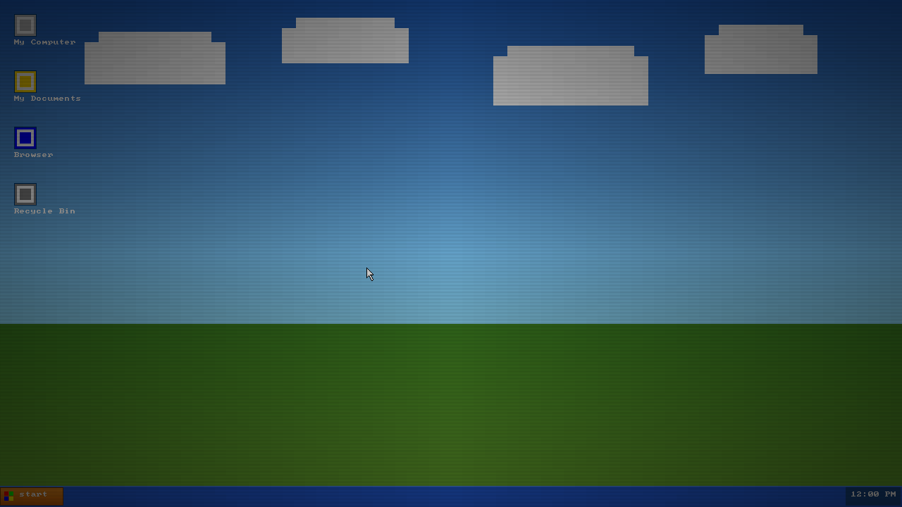

# Welcome to GTos!

A small, bootable x86_64 operating system written from scratch in Rust. No
Linux, no `std`, no libc: the kernel owns the machine from the moment the
bootloader hands over the CPU until `shutdown`.

It boots on legacy BIOS **and** UEFI from the same kernel binary, draws a
framebuffer text console with its own 8x8 font renderer, mirrors everything to
COM1, sets up a heap, an IDT, the 8259 PIC and the PIT, and serves an
interactive shell over the PS/2 keyboard or a serial line.

## Features

- **Bare-metal kernel** (`#![no_std]`, `#![no_main]`, `x86_64-unknown-none`)
  entered through the `bootloader` 0.11 API, which provides BootInfo, a
  framebuffer, identity-free physical-memory mapping and a kernel stack.
- **One kernel, two firmware paths** – the build produces `gtos-bios.img` and
  `gtos-uefi.img`.
- **Bootable ISO** – the same kernel also ships as `gtos.iso`, a hand-written
  ISO9660 + El Torito disc image that boots under UEFI and is Ventoy-compatible.
- **Framebuffer console** – 8x8 bitmap font, scaled 1x–3x to target ~80 columns,
  ANSI-free colour palette, scrolling, tab/backspace/CR/LF handling, and a
  serial mirror on COM1 so the same text is machine-readable. When firmware
  reports no linear framebuffer, the console falls back to the legacy VGA text
  buffer at `0xb8000`, with all sixteen text colours, a hardware cursor and the
  same scrolling/wrapping logic (see
  [Console and VGA fallback](03-architecture.md#console-fallback)).
- **Heap** – a fixed-size block allocator (a free list per size class with a
  `linked_list_allocator` fallback) over the top of the largest usable region,
  capped at 32 MiB, reached through the bootloader's physical-memory window
  (post-10 builds the heap and its `#[global_allocator]`; post-11 supplies the
  allocator's own design, and both are exercised in-QEMU by `basic_boot`).
- **Paging** – the kernel owns its page tables: `memory` reads `CR3`, walks the
  four-level table both by hand and through an `OffsetPageTable`, and can map a
  page from a frame allocator over the bootloader's memory map. `usermode` builds
  the ring-3 window on the same tables, and the in-QEMU tests exercise the paging
  API directly (post-08).
- **Interrupts** – own IDT (with CPU-exception reporters), 8259A remap to
  vectors 0x20–0x2F, PIT at 100 Hz, IRQ1 keyboard, IRQ4 COM1. The double-fault
  handler runs on its own interrupt stack (a GDT + TSS + IST), so a kernel stack
  overflow is caught instead of triple-faulting the machine. Every lock a handler
  shares with the main thread (the serial/console print path, the VGA text
  buffer) is taken inside `without_interrupts`, so a handler that prints can
  never deadlock the thread it interrupted (post-07).
- **Input** – lock-free SPSC ring buffer; PS/2 scancode set 1 with Shift and Caps
  Lock. The keyboard interrupt queues the raw scancode for the async decoder and
  the serial interrupt writes bytes directly.
- **Async runtime** – a cooperative multitasking layer: a `Task` wrapping a
  `Pin<Box<dyn Future>>`, the post's naive `SimpleExecutor`, and a waker-based
  `Executor` that polls only the tasks that were woken and parks the CPU with
  `hlt` when none are ready. The keyboard interrupt handler no longer decodes in
  the interrupt: it pushes raw scancodes into a lock-free queue and wakes an async
  task that decodes them into the shared input queue (post-12).
- **Windows XP-style desktop** – when a framebuffer is available the kernel boots
  straight into a Luna-blue desktop: a vertical gradient, a taskbar with a green
  **start** button, draggable windows with blue title bars and close buttons, a
  Start menu, and a PS/2 mouse-driven arrow pointer. See
  [Desktop environment](04-desktop.md).
- **Shell** – `help`, `echo`, `clear`, `mem`, `heap`, `alloc`, `uptime`, `cpu`,
  `logo`, `about`, `net`, `dhcp`, `ping`, `dns`, `http`, `beep`, `tone`, `disks`,
  `ls`, `cat`, `write`, `rm`, `play`, `format`, `run`, `pkg`, `panic`, `reboot`,
  `shutdown`.
- **Networking** – an RTL8139 driver plus a hand-written IPv4 stack (ARP, ICMP,
  UDP, DNS and a synchronous TCP client) with a DHCP client, so the OS can
  `ping`, resolve host names and fetch web pages over HTTP. See
  [Networking](06-networking.md).
- **Sound** – an AC'97 driver that plays PCM WAV files and synthesised tones
  through QEMU's audio backend. See [Audio](07-audio.md).
- **Disks** – an ATA PIO driver and a read/write FAT16 filesystem, so the OS can
  list, create, read, overwrite and delete files on a real IDE disk. See
  [Disks and the FAT16 filesystem](08-disks.md).
- **User mode** – a real ring-3 execution environment: its own GDT, a TSS with a
  dedicated ring-0 stack, a private page-table window and an `int 0x80` system
  call gate, so flat binaries run with hardware isolation. See
  [User mode (ring 3)](05-user-mode.md).
- **Tests** – an in-QEMU `cargo test` framework (`cargo xtest`) runs unit and
  integration tests inside the kernel itself, and an end-to-end smoke test boots
  the image, drives the shell over a TCP-attached COM1 and asserts on the
  transcript, for both BIOS and UEFI. See [Testing](11-testing.md).
